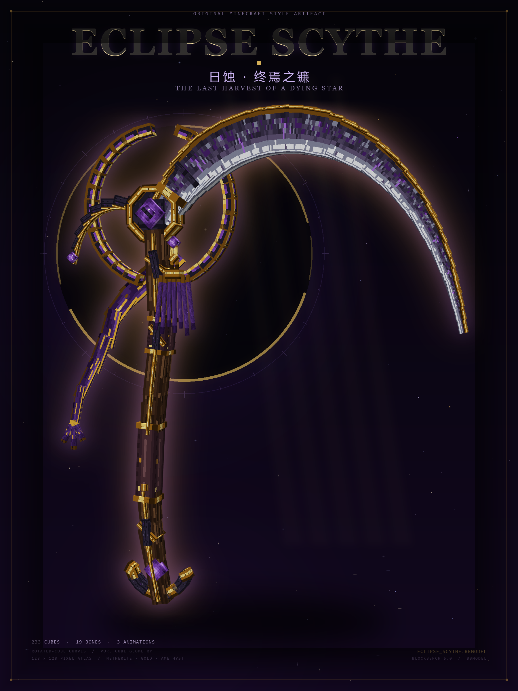
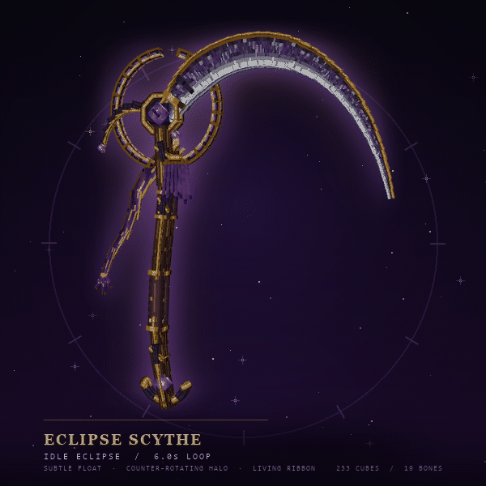
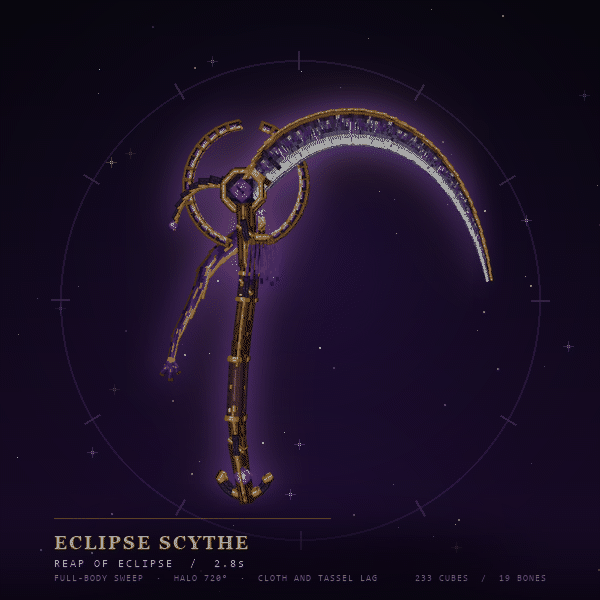

# Eclipse Scythe / 日蚀 · 终焉之镰

一把完全原创的 **Minecraft 风格巨型镰刀**。纯 cube 建模，没有任何 mesh；所有弧线都由长条 cube 沿曲线逐段旋转、重叠构成，而不是用大小块堆叠。

---

## 核心数据

| 项目 | 数据 |
| --- | --- |
| 格式 | `.bbmodel`（Blockbench 通用模型 / free） |
| 几何 | **233 个 cube**，0 个 mesh |
| 旋转 cube | **229 / 233** 带非零旋转 |
| 骨骼 / 组 | **19 个** |
| 贴图 | **128 × 128** RGBA 单图集，2×2 chunky texel，Nearest 采样 |
| 模型尺寸 | 约 **165 × 187 × 17** Blockbench units（X × Y × Z） |
| 动画 | **3 段**，16 根动画骨骼 |
| 文件 | 贴图内嵌于 `.bbmodel`，无外部依赖 |

> 模型以握把附近为原点，Y 轴向下延伸。若放入引擎作为巨型武器 / Boss 武器，请按需设置 root offset 或 display transform。233 个 cube 的密度适合展示、巨型武器或 Boss 掉落物，不适合普通 16×16 手持物品。

---

## 动画

| 名称 | 长度 | 循环 | 说明 |
| --- | --- | --- | --- |
| `idle_eclipse` | 6.0 s | Loop | 整体呼吸浮动、头部微摆、光环反向旋转、布带与流苏延迟摆动 |
| `reap_of_eclipse` | 2.8 s | Once | 全身蓄力—横斩—回正；光环 720°、核心高速旋转、布带大幅甩动 |
| `eclipse_awaken` | 4.2 s | Once | 从地下升起，过冲回弹，光环展开旋转，适合召唤 / 出场 |

在 Blockbench 中打开后，切到 **动画模式（Animate）**，在时间轴左侧选择对应动画即可播放。Idle 建议开启循环预览。

动画 GIF：

---

## 文件清单

| 文件 | 内容 |
| --- | --- |
| `eclipse_scythe.bbmodel` | **主文件**，含几何、UV、内嵌贴图、3 段动画 |
| `eclipse_scythe.png` | 128 × 128 原始贴图图集 |
| `eclipse_scythe_texture_preview.png` | 图集放大预览 |
| `eclipse_scythe_render.png` | 2000 × 2000 透明背景 hero render |
| `eclipse_scythe_poster.png` | 1800 × 2400 展示海报 |
| `eclipse_scythe_preview.png` | 1600 × 2000 无字净版预览 |
| `eclipse_scythe_head_detail.png` | 头部 / 核心特写 |
| `eclipse_scythe_idle.gif` | 600 × 600，50 帧循环 |
| `eclipse_scythe_reap.gif` | 600 × 600，28 帧 |

---

## 设计说明

- **轮廓**：巨大的新月形主刃 + 反向小勾刺 + 破碎日蚀光环，形成非对称但平衡的巨型镰刀剪影。
- **曲线做法**：主刃、护手、镰柄、底部月牙坠、光环、飘带都使用「长 cube 沿贝塞尔 / 圆弧逐段旋转并重叠」的方式生成。重叠段做了轻微 Z 偏移，避免共面 z-fighting。
- **材质**：黑化下界合金、古金、紫水晶 / 灵魂紫。贴图按 2×2 chunky texel 量化，保持 Minecraft 的颗粒感；主刃同时有实体金色背脊、银色开刃和紫色灵魂矿脉。
- **细节**：八边形日蚀核心、前后双面核心宝石、双层皮革握把、金色镶嵌镰柄、七股流苏、八段链式飘带、断裂光环。
- **原创性**：没有使用任何现有模型几何或贴图。所有坐标、曲线控制点、UV、像素纹理和关键帧均从零生成。

---

## 打开与检查

1. 使用 **Blockbench 5.0.7**（或其他支持 bbmodel 5.0 的版本）打开 `eclipse_scythe.bbmodel`。
2. 模型有内嵌贴图，不需要额外加载 `eclipse_scythe.png`；该 PNG 仅作为单独资产提供。
3. 在 **Animate** 模式选择动画；时间轴长度已按表中数据设置。
4. 如需单独使用贴图，在 Blockbench 纹理面板中导出或直接使用 `eclipse_scythe.png`。

---

*Original concept, geometry, pixel texture, animation and presentation — created for this project.*
